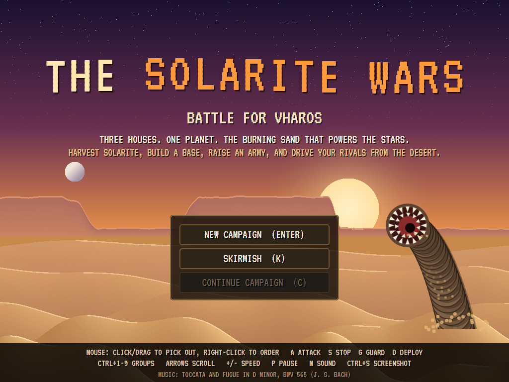
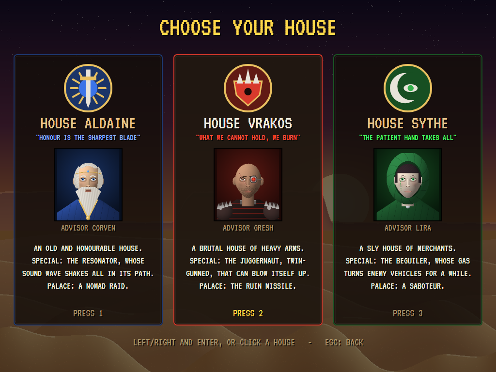
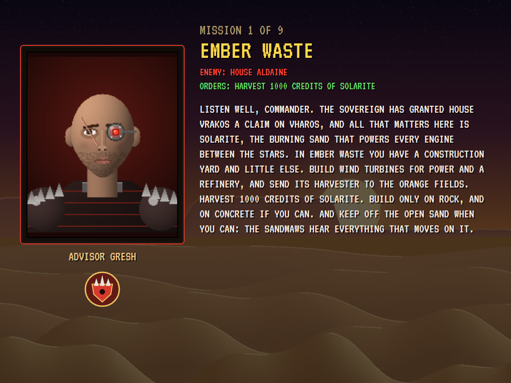
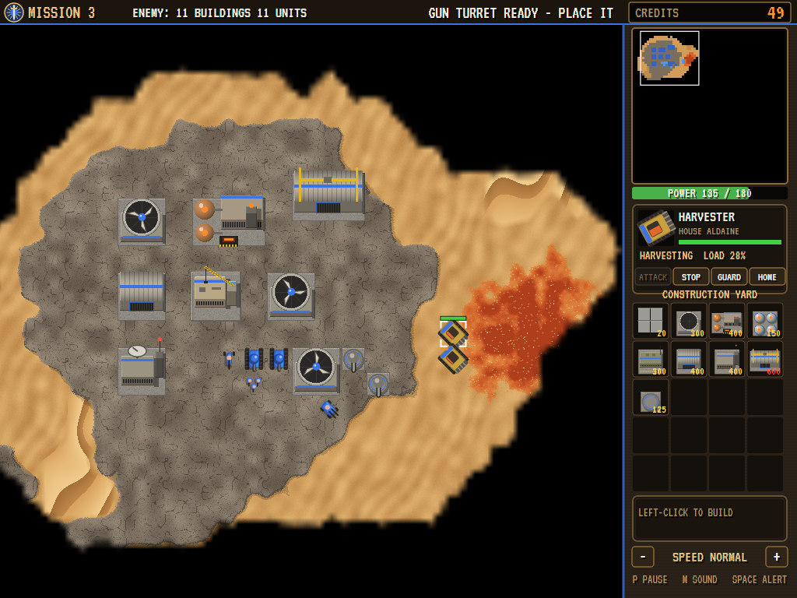
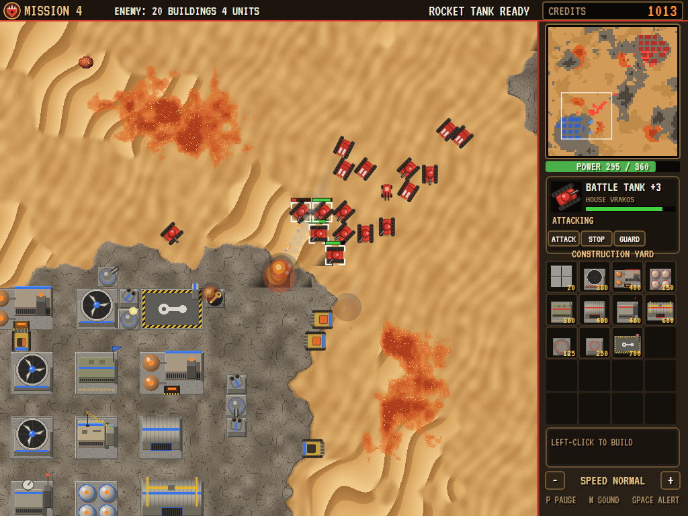
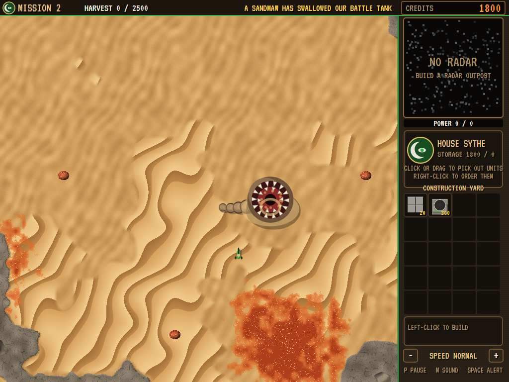
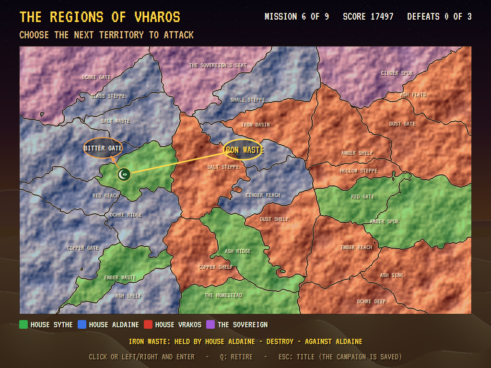
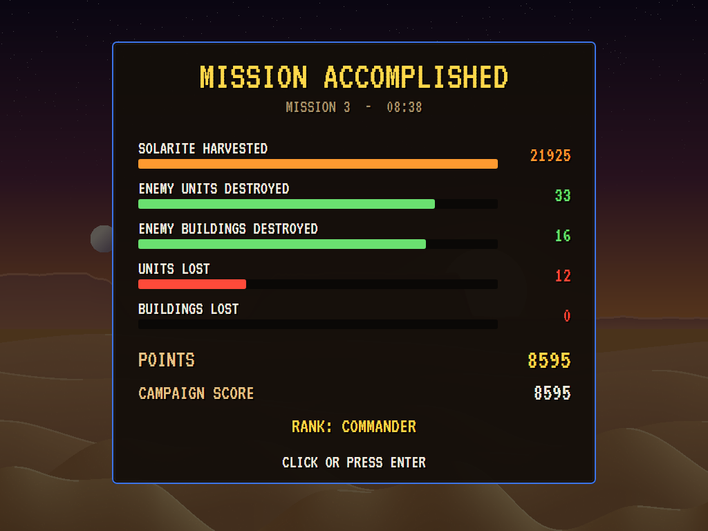
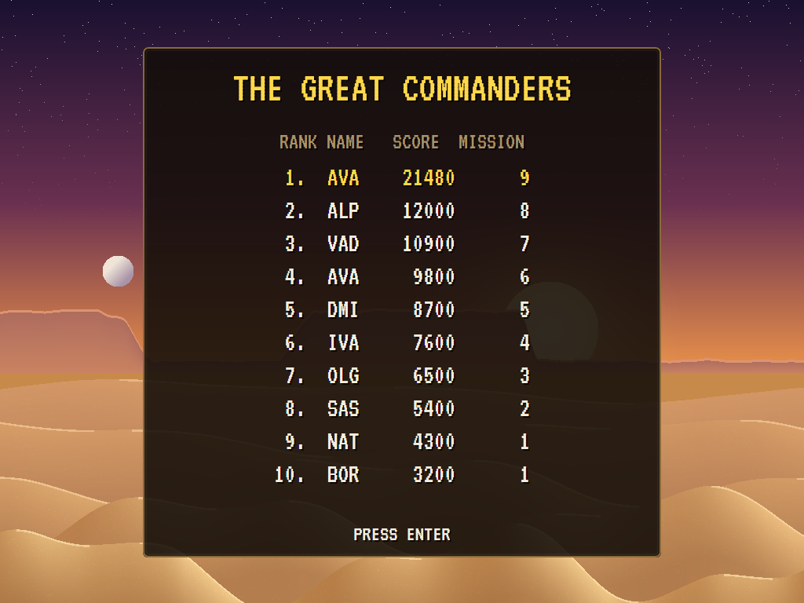

# AVA Dune II

[](https://github.com/Harlock123/AVADune2/actions/workflows/build.yml)

A real-time strategy game in the style of Westwood Studios' 1992 **Dune II: The Building of a Dynasty**, built with
.NET 10 and Avalonia UI. In the game it is called **The Solarite Wars: Battle for Vharos**, with a world of its own
(see [About and licence](#about-and-licence)). Three great Houses fight over the desert planet Vharos for
solarite, the burning orange sand that powers every engine between the stars. Choose a House, build a base on the
rock, send harvesters out to the solarite fields, raise an army, and take the planet territory by territory across
nine missions, until the Sovereign who rules you all turns against you in the last of them.

## Features

- **The battlefield** is 64 by 64 tiles seen from above, scrolling under a sidebar: open sand, slow-going dunes,
  plateaus of rock (the only ground to build on) and mountains (that only infantry can cross), with drifts of
  solarite on the sand and blooms that burst into new fields. Everything is drawn here, pixel by pixel, and the
  edges between sand and rock wander naturally rather than following the grid. The **shroud** hides the map until
  your units and buildings have seen it.
- **Building a base:** the construction yard builds one building at a time, paid for as the work goes on; when it's
  done, click it in the menu and put it down **on rock, next to your base** (within two tiles of one of your
  buildings or your concrete, so lanes can run between). Put it on **concrete** first and it stands at full
  strength; on bare rock it starts at six tenths. Buildings: the **construction yard** (from a **mobile yard** that
  unfolds on open rock), **concrete**, the **wind turbine** (power), the **refinery** (comes with a harvester), the
  **silo**, the **barracks**, the **light**, **heavy** and **high-tech factories**, the **radar outpost**, **gun**
  and **rocket turrets**, **walls**, the **repair pad**, the **starport** and the **palace**. A new one comes with
  each mission, as in the original: concrete, turbines, refineries and silos first; barracks, the light factory and
  the outpost in the second; tanks and turrets in the third; and so on to the palace in the eighth.
- **Power:** each turbine makes 100 (less when it's damaged) and almost every other building uses some. Short of
  power, every factory slows, the radar goes dark and the turrets slow down or stop. The bar under the radar shows
  power used against power made, and an alarm sounds when it runs short.
- **The economy:** harvesters drive to the nearest solarite, fill up (700 credits a load), take it home to a
  refinery and unload, and go back for more. The refinery and every silo store 1,000 credits; what they can't hold
  is lost, and you're told to build silos. The credits counter ticks up as the solarite comes in. A refinery left
  with no harvester (and no heavy factory to build one) has one flown in for 300 credits. **Skylifters** from the
  high-tech factory pick up harvesters with a long way to go and fly them home or out to the field.
- **The factories** queue up to five units each, with a progress bar; set a factory's rally point by picking it out
  and right-clicking the map. Units: **infantry** (rifles) and **troopers** (rockets) from the barracks; the
  **trike** and the twin-gunned **quad** from the light factory; the **battle tank**, the long-range **rocket tank**,
  the **siege tank**, the **harvester** and the **mobile yard** from the heavy factory; the **skylifter** from the
  high-tech factory. Each House has a special of its own:
  - **Aldaine** (blue), honourable: the **resonator**, whose sound wave shakes everything along its line (its own
    side too, if less). Its palace calls a **nomad raid**: four squads of desert warriors on the enemy's base.
  - **Vrakos** (red), brutal: the **juggernaut**, a twin-gunned giant that can blow itself up (D). Its palace fires
    the **ruin missile**, devastating and never quite where it was aimed.
  - **Sythe** (green), sly: the **beguiler**, whose gas turns enemy vehicles to your side for 25 seconds. Its
    palace sends out a **saboteur**, who walks into an enemy building and destroys it.
- **Fighting:** bullets are best against infantry, cannon against vehicles, rockets against armour (and they're the
  only weapons that reach a skylifter); rocket tanks can't fire up close. Tracked vehicles drive over enemy infantry.
  Buildings that fall sometimes leave a few survivors. Units guard where they stand, go after what comes near and
  return; on guard (G) they go further. Attack-move (A, then click) fights everything on the way.
- **Sandmaws:** giant creatures swim under the open sand, show only as a wake, and come up to swallow whatever moves
  on it, harvesters above all (their thumping draws them). They never come onto rock or concrete. After three meals
  (or when hurt enough by your guns) one dives deep and comes back somewhere else later.
- **The starport** sells eight kinds of unit at prices that change every forty seconds; the frigate lands with the
  order twelve seconds later.
- **The enemy** builds and rebuilds its base (lost buildings go back where they stood), keeps its power up, puts
  turrets out toward you, keeps two harvesters to a refinery and a skylifter or two, trains an army, repairs what's
  damaged, turns everything on anything that comes near its base, and sends attack waves that grow as the battle
  goes on, at your buildings and now and then at your harvesters. It fires its palace's weapon when it's ready. With
  two enemies, the second waits longer before its first attack.
- **The campaign:** nine missions across the region map of Vharos, from your homestead at the bottom to the
  Sovereign's seat at the top. After each win you choose the next territory to attack from the ones next to the last
  you took, and your advisor (Corven of Aldaine, Gresh of Vrakos or Lira of Sythe, painted pixel by pixel, who
  blink and talk) briefs you. The first two missions ask you to harvest 1,000 and 2,500 credits; the rest, to
  destroy every enemy building and unit. In the eighth both rival Houses stand against you, and in the ninth the
  Sovereign sends his Praetors to join them. A lost mission can be tried again; the third defeat ends the campaign.
  The campaign is saved at the region map and can be continued from the title.
- **The score** after each mission: solarite harvested, enemy units and buildings destroyed, your losses, the time
  taken, the points and your rank, from Sand Rat to Master of Vharos. The campaign's score goes on the high-score
  table with your initials.
- **Skirmish:** you against one or two computer Houses, everything available from the start.
- **The demonstration** plays a skirmish with the computer on both sides, the camera drifting to wherever the
  fighting is. The computer's play for you (the pilot) wins the first six missions of the campaign for every House.
- **Game speed** from slowest to fastest (+ and -), and a pause.

## Screenshots

| The title | Choosing a House | The briefing |
|:---------:|:----------------:|:------------:|
|  |  |  |
| A sandmaw breaches. | Aldaine, Vrakos or Sythe. | Advisor Gresh, mission one. |

| An early base | A battle | A sandmaw |
|:-------------:|:--------:|:---------:|
|  |  |  |
| Harvesting, mission three. | Tanks at the enemy's gates. | One tank fewer. |

| The region map | The score | The great commanders |
|:--------------:|:---------:|:--------------------:|
|  |  |  |
| Where next? | After mission three. | The high scores. |

The screenshots are made by the tests, which play the game in a real (headless) window; see [Tests](#tests).

## Download and run

Ready-to-run builds for Windows, macOS and Linux, on both Intel/AMD and ARM, are on the
[Releases page](https://github.com/Harlock123/AVADune2/releases/tag/latest). **Latest build** is rebuilt on every
push to `main`. Each download is one self-contained executable: no .NET install is needed.

| Platform | Archive |
|---|---|
| Windows | `AVADune2-win-x64.zip`, `AVADune2-win-x86.zip`, `AVADune2-win-arm64.zip` |
| macOS | `AVADune2-osx-arm64.tar.gz` (Apple silicon), `AVADune2-osx-x64.tar.gz` (Intel) |
| Linux | `AVADune2-linux-x64.tar.gz`, `AVADune2-linux-arm64.tar.gz`, `AVADune2-linux-arm.tar.gz` |

```bash
tar -xzf AVADune2-linux-x64.tar.gz     # or linux-arm64, linux-arm, osx-arm64, osx-x64
./AVADune2
```

On Windows, unzip and run `AVADune2.exe`. On macOS, if Gatekeeper refuses to open it, run
`xattr -d com.apple.quarantine AVADune2` once. Run with `--no-audio` for silence.

**Sound** comes through OpenAL Soft, built in for every platform. In a virtual machine the game detects it and uses
a larger audio buffer, so the sound doesn't break up.

**Gamepads** use SDL2, which is bundled for Windows, macOS and Intel/AMD Linux. ARM Linux builds need it installed;
without it the keyboard and mouse still work:

```bash
sudo apt install libsdl2-dev            # Debian / Ubuntu / Raspberry Pi OS
sudo pacman -S --needed sdl2-compat     # Arch / Omarchy
```

## Controls

The game is played with the mouse, as the original was; the keys are shortcuts.

| Action | Mouse | Keyboard | Gamepad |
|---|---|---|---|
| Pick out a unit or building | Left-click (Shift: add or remove a unit) | | A |
| Pick out units in a box | Drag | | |
| Every unit of a kind on screen | Double-click | | |
| Move, attack, harvest, go home, repair | Right-click the ground, an enemy, solarite, a refinery or the repair pad | | B |
| Attack-move | | A, then click | Y, then A |
| Stop / guard | | S / G | X (stop) |
| Deploy a mobile yard; blow up a juggernaut | | D | |
| Groups | | Ctrl+1 to 9 to make; 1 to 9 to pick out (twice: look at them) | |
| Scroll the map | Push against the screen's edge; click or drag on the radar | Arrows | Right stick or D-pad |
| Build | Left-click an item in the sidebar (right-click: one fewer, or cancel) | | |
| Put a building down | Click its READY item, then click the rock (right-click: not yet) | | |
| A factory's rally point | Pick it out, then right-click the map | | |
| Repair a building | Pick it out, then REPAIR | R | |
| The palace's weapon | Pick it out, then LAUNCH (the ruin missile: then click its target) | L | |
| Look at the last attack / at the base | | Space / H | |
| Game speed | The - and + buttons | - and + | |
| Pause | | P or Esc (Q in the pause: leave the battle) | Start |
| Sound on/off | | M | |
| Screenshot | | Ctrl+S (to your Pictures folder) | |

On the gamepad the left stick moves a cursor of its own, and A and B click with it. On the title, Enter starts a
campaign, K a skirmish and C carries on a saved campaign; on the high-score table, type your initials (or use
up/down and Space), then Enter.

## Tests

```bash
dotnet test AVADune2.slnx
```

The game runs in fixed 60 Hz steps (more or fewer of them at the faster and slower speeds), so it plays the same at
any frame rate. The 69 tests check:

- **The base:** buildings only on rock, clear of other buildings and units, next to the base and never on the
  enemy's concrete; concrete for full strength and to reach further; the mobile yard unfolding only on open rock.
- **Power:** turbines making it (less when damaged), buildings using it, low power slowing the factories, darkening
  the radar and stopping the turrets.
- **Building:** the yard working one building at a time and waiting for it to be put down; credits paid as the work
  goes on and refunded on cancelling; queues of five, units out of the door to the rally point; tech levels,
  prerequisites and each House's own units.
- **The economy:** a refinery's harvester filling up and unloading exactly a load; storage in refineries and silos;
  a replacement harvester flown in; blooms bursting under a unit or a shot; the starport's changing prices and its
  frigate; repairing buildings and mending vehicles at the repair pad.
- **Combat:** every unit's numbers; fights won by the heavier side and even fights close; rockets outranging cannon;
  tanks crushing infantry; the resonator's wave, the beguiler's gas, the juggernaut's blast; turrets (and rocket
  turrets against skylifters); kills and losses counted; each palace's weapon, and the saboteur.
- **Finding the way:** round mountains that infantry can cross; as near as possible to an unreachable goal; a group
  spreading over its own tiles; a few paths worked out a step; **300 units fighting in a battle**, the whole
  world stepping in well under a millisecond on average (the test allows four).
- **Sandmaws:** swallowing on sand and never coming onto rock, harvesters first; diving after three meals or when
  hurt, and coming back; units shooting at one that comes up.
- **Skylifters** flying a full harvester home, and both lost when one is shot down.
- **The player's hand:** clicking, boxes, Shift and double-clicks; right-clicks that attack, harvest, send home,
  repair and set a rally point; attack-move, stop, guard, deploy and groups; the menu, placing and cancelling; the
  shroud; what the player hears.
- **The computer:** keeping its power up, rebuilding where buildings stood, repairing; training an army and
  harvesters and attacking in waves; defending its base; the pilot winning the first three missions.
- **The game:** harvesting and destroying missions won, and lost with nothing left; the score; a campaign from the
  title through the region map, a briefing, a win and the save; three defeats ending it with a high score; skirmishes
  against one or two Houses; the region map's choices up to the Sovereign's seat; every mission map passable with
  solarite near home; saving and loading; the keys (up is up, and a Shift let go as CapsLock is let go); scrolling
  by keys and the screen's edge; game speeds; pausing; the demonstration and the high scores; and the canvas's keys
  and clicks in a headless window.

`tests/AVADune2.Tests/PilotProbe.cs` reports how the pilot gets on mission by mission, for tuning
(`DUNE_PROBE=1 DUNE_MISSIONS=9`, `DUNE_HOUSE=0..2`). It wins the first six missions for each House, in two to
sixteen minutes each, and loses the last three, which are meant to be hard. `DUNE_PROBE=lazy` leaves the player's
side to sit still.

The screenshot tests draw the real screen in a headless window. To refresh the README's pictures:

```bash
DUNE_SHOTS=$PWD/Images dotnet test tests/AVADune2.Tests --filter ScreenshotTests
```

## Building

```bash
dotnet build AVADune2.slnx
dotnet run --project src/AVADune2
```

Needs the .NET 10 SDK. The sounds, music and voices are made by `tools/make_sounds.py` (standard-library Python,
with the formant voice in `tools/speech.py`): `python3 tools/make_sounds.py` rewrites `src/AVADune2/Sounds`.

## Project structure

```
AVADune2/
├── AVADune2.slnx
├── src/AVADune2/
│   ├── Engine/
│   │   ├── GameEngine.cs        # States, the campaign's flow, the camera, picking out and ordering, the menus
│   │   ├── World.cs             # The battlefield: ground, solarite, concrete, Houses, buildings, units, shots
│   │   ├── Rules.cs             # Every building's and unit's numbers, the Houses' names, colours and advisors
│   │   ├── Sim.cs               # Power, storage, factories, placing, the starport, the palace, blooms, the shroud
│   │   ├── Sim.Units.cs         # Orders, moving, harvesting, repairing, deploying, skylifters
│   │   ├── Sim.Combat.cs        # Targets, weapons, damage, turrets, sandmaws
│   │   ├── PathFinder.cs        # A* over the tiles, a few searches a step
│   │   ├── MapGen.cs            # Mission maps: rock, dunes, solarite, bases, units
│   │   ├── Brain.cs             # The computer's mind (and the pilot's)
│   │   ├── Pilot.cs             # The player's side played by the computer, and where to look
│   │   ├── Campaign.cs          # The region map, the missions, the briefings, the score
│   │   ├── SaveFile.cs          # The campaign saved between missions
│   │   ├── HighScoreTable.cs, InitialsEntry.cs
│   │   ├── InputHandler.cs, ControllerManager.cs  # Keys, the mouse and an SDL2 gamepad
│   │   └── SoundManager.cs      # Effects, music and voices through OpenAL
│   ├── Audio/                   # The OpenAL engine (from the author's AVABand)
│   ├── Views/
│   │   ├── GameCanvas*.cs       # The battlefield, units and effects, the sidebar, the screens
│   │   ├── MapPainter.cs        # The ground, the radar and the shroud, drawn pixel by pixel
│   │   ├── BuildingArt.cs       # The buildings, drawn pixel by pixel in their Houses' colours
│   │   ├── Portraits.cs         # The advisors
│   │   └── Pix.cs               # A little picture to draw into
│   └── Sounds/                  # The synthesised effects, music and voices
├── tests/AVADune2.Tests/        # Gameplay, combat, engine, canvas and screenshot tests, and the pilot's probe
├── tools/make_sounds.py, tools/speech.py
└── Images/                      # Screenshots
```

## About and licence

AVA Dune II © 2026 Lonnie Watson, under the [MIT License](LICENSE).

AVA Dune II is an independent, unofficial game in the style of *Dune II: The Building of a Dynasty* (also known as
*Dune II: Battle for Arrakis*). *Dune II* © 1992 Westwood Studios / Virgin Games. *Dune* is a trademark of Herbert
Properties LLC. No names or material from either are used: the planet, its mineral, the Houses, their advisors, the
units and the creatures are all the game's own (Vharos, solarite, Aldaine, Vrakos and Sythe, the Sovereign,
skylifters, sandmaws and the rest), as are its graphics, sounds and code; nothing is taken from the original game's
program, graphics or sound. It is not affiliated with or endorsed by any rights holder.

The title music is the opening of Johann Sebastian Bach's *Toccata and Fugue in D minor*, BWV 565, which is in the
public domain; the battle music, the victory fanfare and the lament are the game's own. The font is VT323 (SIL Open
Font License, `src/AVADune2/Assets/Fonts/VT323-OFL.txt`).
